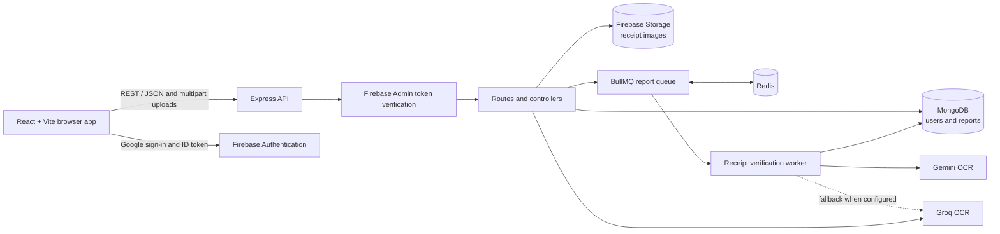

# 🚗 ETwenty
Deployed Site - [ETwenty](https://etwenty-front.onrender.com/)

> 🌍 E20 fuel compatibility for vehicles in India
> ✅ Verified reports • 📍 Station risk insights • 🤖 AI-powered receipt checks

ETwenty is a web app for checking vehicle compatibility with E20 fuel, reporting fuel-related vehicle issues, and exploring verified reports and station risk across India. Users can submit a report with a receipt; an asynchronous OCR workflow checks the receipt and leaves reports needing judgment available for admin review.

## Testing 
```Unit testing done using Codex agent```

## ✨ Features

- 🚗 **Vehicle compatibility:** Look up vehicle compatibility and get an AI-generated estimate.
- 🧾 **Community reports:** Submit issue details, station/location information, and a receipt image. Browse verified reports with search and filters.
- 🔎 **Receipt verification:** OCR extracts receipt details and checks the station name and date before marking a report as verified.
- 📊 **Insights and maps:** Explore report statistics, station risk scores, and geographic report density.
- 👤 **Account and moderation:** Sign in with Google, manage your reports, and use the admin dashboard to review, verify, or remove reports.


## ETwenty Working Algorithm and Formulas


## 🖼️ Screenshots 


## 🌟 At a glance

- 🚘 Check whether a vehicle is compatible with E20
- 📍 Explore station-level risk and density on live maps
- 🧠 Use AI-assisted OCR to verify fuel receipts
- 🛡️ Review and moderate submitted issues from an admin dashboard

## 🧰 Technology stack

| Area | Technologies |
|---|---|
| Frontend | React 19, Vite, Tailwind CSS, DaisyUI, React Router |
| Maps and charts | React Leaflet, Leaflet.heat, Leaflet marker clustering, Recharts |
| HTTP and authentication | Axios, Firebase Authentication (Google sign-in) |
| Backend | Node.js, Express 5, Mongoose |
| Database | MongoDB Atlas |
| Identity, receipt storage | Firebase Admin, Firebase Storage |
| Background processing | Redis, BullMQ, ioredis |
| AI | Google Gemini for receipt OCR; Groq as an optional OCR fallback and for compatibility estimates |
| Integrations | Google Maps Places for station search; OpenStreetMap tiles for the map |

## Deployment 
- Frontend And Backend : Render Free Tier
- Redis : Upstash
## 🏗️ Architecture



The client uses a shared Axios API client. Authenticated requests include the signed-in user's Firebase ID token; Express middleware verifies it, and admin endpoints also check the user's role in MongoDB.

## 🎯 Problem Statement and Target Users

### Who is ETwenty for?

- **Vehicle owners:** Check E20 compatibility and understand the reliability of reported fuel-related issues.
- **Used vehicle buyers:** Research vehicle compatibility and reported station issues before purchasing or refuelling.
- **Community contributors:** Submit fuel-related reports with supporting receipts.
- **Administrators:** Review, verify, and moderate community-submitted reports.

### Problem

Vehicle owners may struggle to find reliable, model-specific E20 compatibility information and trustworthy reports about fuel-related issues at petrol stations.

ETwenty aims to make this information easier to access through compatibility estimates, receipt-assisted reports, and geographic insights.

## 🔍 Existing Solutions and Competitive Analysis

| Existing solution             | Strength                                      | ETwenty's differentiation                                        |
| ----------------------------- | --------------------------------------------- | ---------------------------------------------------------------- |
| Vehicle manufacturer websites | Authoritative compatibility information       | Combines compatibility lookup with community reports             |
| FuelSaathi                    | Source-linked E20 compatibility catalogue     | Focuses on user-submitted fuel issues and station-level insights |
| Moto Metric                   | Compatibility reports and vehicle comparisons | Adds community reporting, receipt verification, and moderation   |
| Google Maps                   | General location and business discovery       | Adds fuel-issue reports and station risk indicators              |

ETwenty complements official manufacturer information; it does not replace it.

## ⚖️ Engineering Trade-offs

| Decision                   | Benefit                                       | Trade-off                                              |
| -------------------------- | --------------------------------------------- | ------------------------------------------------------ |
| MongoDB                    | Flexible report schema and geospatial queries | Requires careful indexing and data validation          |
| Firebase Authentication    | Simplifies Google sign-in                     | Introduces dependency on an external identity provider |
| Gemini + Groq              | Multiple OCR providers                        | Different extraction quality, latency, and API limits  |
| BullMQ + Redis             | Asynchronous OCR and retry support            | Additional infrastructure and operational complexity   |
| Community reports          | Real-world local insights                     | Vulnerable to inaccurate or malicious submissions      |
| AI compatibility estimates | Helps handle missing catalogue data           | Cannot guarantee manufacturer-approved compatibility   |

## 🚧 Known Limitations and Unresolved Problems

| Limitation                           | Current impact                                    | Planned solution                                                    |
| ------------------------------------ | ------------------------------------------------- | ------------------------------------------------------------------- |
| AI-generated compatibility estimates | May be inaccurate or unsupported                  | Prioritize manufacturer-sourced records and clearly label estimates |
| Receipt OCR errors                   | Incorrect station names or dates may be extracted | Improve confidence thresholds and manual review                     |
| Public receipt storage               | Potential exposure of personal information        | Use private storage, signed URLs, and retention policies            |
| Limited report authenticity checks   | Receipts and reports may be manipulated           | Add duplicate detection and stronger moderation                     |
| Station risk score limitations       | Sparse or biased reports may distort scores       | Add minimum sample sizes, confidence intervals, and time decay      |
| My Reports lacks pagination          | Large user histories may become slow              | Implement server-side pagination                                    |
| External service dependency          | Provider outages can interrupt features           | Add retries, circuit breakers, and graceful degradation             |

## 🛡️ Fallback and Failure Handling

| Failure                             | Fallback                                                                        |
| ----------------------------------- | ------------------------------------------------------------------------------- |
| Gemini OCR unavailable              | Retry supported models, then use Groq if configured                             |
| Both OCR providers unavailable      | Keep report pending and allow admin review                                      |
| Redis unavailable                   | Reject or defer report verification safely; do not claim verification succeeded |
| Compatibility API unavailable       | Show an unavailable state and direct users to manufacturer sources              |
| Maps or Places API unavailable      | Preserve report submission with manual station/location entry                   |
| Authentication provider unavailable | Explain sign-in failure and preserve non-sensitive form data where possible     |

### Receipt submission and verification

1. A signed-in user submits a report and receipt image as multipart form data.
2. The API stores the receipt in Firebase Storage and creates a MongoDB report with a pending verification status.
3. The API enqueues OCR work in Redis using BullMQ and returns an accepted response without waiting for OCR to finish.
4. A background worker tries Gemini OCR models and, if configured and needed, falls back to Groq.
5. The worker compares the extracted station name with the submitted station using normalized, fuzzy token matching, and checks that the receipt date is within the accepted window.
6. The worker saves the extracted receipt data and verification status. Reports that still need a decision can be reviewed in the admin dashboard.

The queue offloads the CPU-/network-intensive receipt-verification work from the report-submission request path, helping avoid HTTP requests waiting on OCR and reducing submission latency.

## ⚙️ Backend highlights

- **Firebase Storage:** Receipt images are stored in the configured Firebase Storage bucket; MongoDB stores the image reference and report data.
- **Asynchronous OCR:** BullMQ queues receipt verification in Redis and a worker processes jobs separately from the API request.
- **Redis idle polling:** The receipt worker waits up to 30 seconds for a job while idle, reducing repeated Redis polling; queued work wakes the waiting worker.
- **Gemini with Groq fallback:** Gemini is tried first for receipt OCR. Groq is used as a fallback when its API key is configured. Groq also powers the compatibility estimate endpoint.
- **Fuzzy station matching:** Station names are normalized for case, accents, punctuation, and word order. Token matching allows up to **20% edit distance** for tokens at least **4 characters** long.
- **NoSQL input sanitization:** `express-mongo-sanitize` sanitizes request data to help prevent MongoDB operator and key injection.
- **Security headers:** Helmet sets HTTP security headers, including protections relevant to clickjacking. It is a defense-in-depth measure, not a guarantee against every attack.
- **Report submission rate limit:** Up to **10 submissions per IP address per 15-minute window**.
- **Receipt verification window:** Receipts dated within the previous **10 days** can pass the date check.
- **OCR fallback sequence:** The worker tries up to **3 Gemini models**, then uses Groq when configured.
- **Pagination:** Browse Reports shows **9 reports per page** and accepts a server-side page size of up to **100**. The admin list defaults to **10 reports per page**. **My Reports currently fetches all reports belonging to the signed-in user and does not yet paginate them.**

## 🎨 Frontend highlights

- **WebM hero background:** The hero background uses `client/public/herotemp.webm` to reduce media loading cost. The reported load time improved from about **321 ms to 73–80 ms** (roughly **75–77% lower**); actual results depend on the device, network, cache, and measurement method.
- **Interactive GIS dashboard:** The Leaflet map offers **2 modes**: a heat layer and clustered station markers. Marker clustering uses chunked loading to handle large station sets without rendering every marker as an ungrouped map element. The reported target is **60 FPS**; actual frame rate depends on device and dataset size.
- **Lazy loading:** Route pages, the heatmap map, and dashboard charts are loaded on demand with React lazy loading and Suspense, reducing the initial bundle work.
- **Admin verification page:** Authorized admins can review paginated reports, update verification status, and delete reports.


## 📄 Application pages

| Path | Page | Purpose |
|---|---|---|
| `/` | Compatibility checker | Check vehicle E20 compatibility |
| `/report` | Report form | Submit an issue and receipt |
| `/my-reports` | My Reports | View and manage your own reports |
| `/browse` | Browse Reports | Search and filter verified public reports |
| `/dashboard` | Dashboard | View report statistics and charts |
| `/heatmap` | Heatmap | Explore report density and station risk |
| `/profile` | Profile | View account and report details |
| `/admin` | Admin dashboard | Review and moderate reports (admin role required) |

## 🔌 API overview

All API routes are mounted under `/api`.

| Prefix | Examples | Access |
|---|---|---|
| `/auth` | `POST /sync` | Firebase token required |
| `/user` | `GET /profile`, `DELETE /account` | Firebase token required |
| `/vehicles` | `GET /check` | Public |
| `/reports` | `POST /`, `GET /`, `GET /mine`, `GET /heatmap`, `GET /station-risk` | Mixed: report management requires a token; browse and map data are public |
| `/dashboard` | `GET /stats` | Public |
| `/admin` | `GET /reports`, `GET /users/count`, `PATCH /reports/:id/status`, `DELETE /reports/:id` | Firebase token and admin role required |

## ▶️ Run locally

### Prerequisites

- Node.js and npm
- Docker
- A MongoDB connection string
- Firebase project credentials with Authentication and Storage configured
- Gemini API key; Groq API key is optional and enables the OCR fallback
- Google Maps API key for station search in the report form

### Install dependencies

From the project root, install each app's dependencies:

```powershell
cd server
npm install

cd ..\client
npm install
```

### Start Redis with Docker

Run Redis locally for the BullMQ queue:

```powershell
docker run --name etwenty-redis -p 6379:6379 -d redis:7-alpine
docker exec etwenty-redis redis-cli ping
```

The ping should return `PONG`. Set the backend's `REDIS_URL` to `redis://localhost:6379`. If the container already exists, start it with `docker start etwenty-redis`.

### Configure environment variables

Create `server/.env`:

```dotenv
PORT=5000
MONGODB_URI=<your MongoDB connection string>
REDIS_URL=redis://localhost:6379

FIREBASE_PROJECT_ID=<your Firebase project ID>
FIREBASE_CLIENT_EMAIL=<your Firebase service-account client email>
FIREBASE_PRIVATE_KEY="<your Firebase service-account private key>"
FIREBASE_STORAGE_BUCKET=<your Firebase Storage bucket name>

GEMINI_API_KEY=<your Gemini API key>
GROQ_API_KEY=<optional Groq API key>
```

The Firebase private key must be provided as an environment value; escaped `\n` sequences are converted by the backend. Do not commit `.env` files or service-account credentials.

Create `client/.env`:

```dotenv
VITE_BASE_API=http://localhost:5000/api
VITE_FIREBASE_API_KEY=<your Firebase web API key>
VITE_FIREBASE_AUTH_DOMAIN=<your Firebase auth domain>
VITE_FIREBASE_PROJECT_ID=<your Firebase project ID>
VITE_GOOGLE_MAPS_API_KEY=<your Google Maps API key>
```

Vite exposes `VITE_` variables in the browser bundle. Only put client-safe configuration there; keep service-account credentials and AI API keys on the backend.

### Start the apps

Run each command in its own terminal:

```powershell
cd server
npm run dev
```

```powershell
cd client
npm run dev
```

Vite prints the local client URL in its terminal. The backend health endpoint is `http://localhost:5000/`.

### Build and lint the client

```powershell
cd client
npm run build
npm run lint
```

## 🗂️ Data model

- **User:** Firebase UID, email, display name, role, and timestamps.
- **Report:** User reference, vehicle and issue details, station and location, receipt image reference, verification status, OCR-extracted receipt details, and timestamps. Locations use GeoJSON coordinates (`[longitude, latitude]`) with a `2dsphere` index.

MongoDB stores report metadata; receipt image objects live in Firebase Storage. Configure bucket access and retention in line with your privacy requirements.

## 🧭 Project layout

```text
client/
  src/
    api/                 Axios API client
    components/          Shared UI, hero, charts, and map
    context/             Authentication, toast, and confirmation contexts
    pages/               Application routes
  public/                Static assets, including the WebM hero background
server/
  config/                MongoDB and Firebase setup
  controllers/           API request handlers
  middleware/             Authentication and admin authorization
  models/                Mongoose User and Report models
  queues/                BullMQ queue and receipt worker
  routes/                Express route definitions
architecture.md           Detailed architecture notes
```

## 📝 Notes

- Admin access depends on the user's `role` in MongoDB; Firebase sign-in alone does not grant admin access.
- Receipt OCR is asynchronous. A successful report submission means the report was accepted for processing, not that verification has already completed.
- The report upload path currently makes the uploaded Storage object public. Review that behavior and bucket permissions before using real or sensitive receipt images.
- The local Redis container is only the queue service; MongoDB, Firebase, Gemini, Groq, and Google Maps remain separately configured services.
