# ETwenty Architecture

## Project overview

ETwenty is a React single-page application for checking vehicle E20-fuel compatibility, submitting fuel-impact reports, and exploring verified reports and station risk. The browser talks to a REST API built with Express. The API stores application records in MongoDB, stores receipt images in Firebase Storage, and sends receipt verification work to a Redis-backed BullMQ worker.

## System flow

```mermaid
flowchart LR
    subgraph Browser["Browser — React + Vite"]
        UI["Pages and components<br/>Compatibility, reports, dashboard, map, admin"]
        Context["Auth, toast, and confirmation contexts"]
        API["Axios API client<br/>VITE_BASE_API"]
        FirebaseClient["Firebase client SDK<br/>Google sign-in and ID tokens"]
        Maps["Google Maps Places<br/>station search in report form"]
        UI --> Context
        UI --> API
        UI --> Maps
        Context <--> FirebaseClient
        FirebaseClient -->|"ID token used by API client"| API
    end

    subgraph Server["Backend — Node.js + Express"]
        Middleware["CORS, JSON parsing,<br/>Mongo sanitization, Helmet"]
        Routes["REST routes"]
        Auth["Firebase Admin token verification<br/>admin role check where required"]
        Controllers["Controllers<br/>business logic and aggregation"]
        Middleware --> Routes --> Auth --> Controllers
    end

    API <-->|"HTTP JSON / multipart form data"| Middleware

    Mongo[("MongoDB Atlas<br/>User and Report documents")]
    Storage[("Firebase Storage<br/>receipt images")]
    Redis[("Redis<br/>BullMQ report queue")]
    Worker["Report processing worker"]
    Gemini["Google Gemini<br/>receipt OCR"]
    Groq["Groq<br/>OCR fallback and compatibility estimate"]

    Controllers <-->|"Mongoose queries and aggregates"| Mongo
    Controllers -->|"upload receipt"| Storage
    Controllers -->|"enqueue report ID and receipt data"| Redis
    Redis --> Worker
    Worker --> Gemini
    Worker -. "fallback if configured" .-> Groq
    Worker -->|"save OCR data and verification status"| Mongo
    Controllers -->|"compatibility estimate"| Groq
```

### Typical request paths

**Sign-in and authenticated API calls**

1. The user signs in with Google using Firebase Authentication in the browser.
2. `AuthContext` listens for Firebase auth-state changes. The Axios client retrieves the current user's Firebase ID token and sends it as a bearer token.
3. Protected Express routes use Firebase Admin to verify the token. The middleware attaches the Firebase UID and email to the request.
4. The auth-sync endpoint creates the corresponding MongoDB user record on first sign-in. Admin routes additionally check the user's `role` in MongoDB.

**Report submission and receipt verification**

1. The signed-in user selects a station using Google Places and submits report fields plus a receipt image as multipart form data.
2. Express authenticates the request and parses the uploaded receipt in memory.
3. The report controller uploads the image to Firebase Storage, creates a `Report` in MongoDB with a pending status, and enqueues OCR work in Redis via BullMQ.
4. The worker extracts receipt details using Gemini, with Groq as an optional fallback. It compares the extracted station and date to the submitted report, then updates the MongoDB report with OCR data and a verification status.
5. Public report browsing, dashboard statistics, and map/risk endpoints use verified reports; users can also view and manage their own reports.

## Frontend

The client is a React 19 SPA built and served during development by Vite. `client/src/main.jsx` mounts the app; `App.jsx` sets up React Router, shared providers, navigation, footer, and lazy-loaded pages.

| Route | Page | Purpose |
|---|---|---|
| `/` | `CompatibilityChecker` | Check a vehicle's E20 compatibility |
| `/report` | `ReportForm` | Submit a vehicle/fuel-impact report with station location and receipt |
| `/my-reports` | `MyReports` | View, edit, and delete the signed-in user's reports |
| `/browse` | `BrowseReports` | Search and filter public verified reports |
| `/dashboard` | `Dashboard` | View aggregated report statistics |
| `/heatmap` | `HeatmapView` | Explore report density and station risk |
| `/profile` | `Profile` | View account/report details and manage account |
| `/admin` | `AdminDashboard` | Moderate reports and view user/report totals |

`client/src/api/api.js` is the shared Axios client. It uses `VITE_BASE_API` as its base URL and adds a Firebase bearer token to requests when a user is signed in. `AuthContext`, `ToastContext`, and `ConfirmContext` provide cross-page state and UI behavior.

## Backend

The server is an ES-module Node.js application. `server/index.js` connects to MongoDB, configures Express middleware, mounts the API routes, starts the HTTP server, and attempts to start the report worker.

| API prefix | Main responsibilities | Access |
|---|---|---|
| `/api/auth` | Sync a Firebase-authenticated user to MongoDB | Token required |
| `/api/user` | Read profile data; delete account and associated reports | Token required |
| `/api/vehicles` | Return an AI-generated E20 compatibility estimate | Public |
| `/api/reports` | Create/manage reports; list verified reports; provide heatmap and station-risk data | Mix of public and token-required endpoints |
| `/api/dashboard` | Aggregate verified-report statistics | Public |
| `/api/admin` | Paginate reports, count users, update report status, and delete reports | Token and admin role required |

Routes apply authentication and upload middleware as needed, then delegate to controllers. Controllers use Mongoose for persistence and aggregation; receipt verification is offloaded from the request path to the BullMQ worker.

## Data and external services

### MongoDB

MongoDB Atlas is the system of record for application data. The Mongoose models are:

- **`User`** — Firebase UID, email, display name, role, and timestamps.
- **`Report`** — reporting user, vehicle and issue details, station/location, repair and mileage information, receipt image reference, verification status, extracted receipt details, and timestamps. The location is stored as GeoJSON coordinates (`[longitude, latitude]`) with a `2dsphere` index.

Reports refer to users through a Mongoose ObjectId reference. The receipt image itself is stored outside MongoDB; the report retains its URL and storage object name.

### Supporting services

- **Firebase Authentication** signs users in on the client. Firebase Admin verifies ID tokens on the server.
- **Firebase Storage** stores uploaded receipt images.
- **Redis + BullMQ** buffer report receipt-verification jobs for the backend worker.
- **Google Gemini** performs receipt image extraction. The worker can fall back to **Groq** when configured.
- **Groq** also powers the vehicle compatibility estimate endpoint.
- **Google Maps Places** supplies station autocomplete/location details in the report form; the heatmap UI renders returned geographic data.

## Configuration boundaries

The client reads public build-time settings through Vite variables, including `VITE_BASE_API`, Firebase client configuration, and `VITE_GOOGLE_MAPS_API_KEY`. The server reads private service configuration from its environment, including `MONGODB_URI`, Firebase Admin credentials, `REDIS_URL`, `GEMINI_API_KEY`, and `GROQ_API_KEY`. Keep server credentials out of client code and source control.
